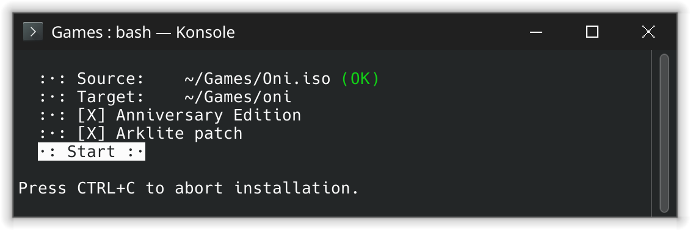

# Oni installer

Installs [Oni](https://oni.bungie.org/) from your own disc (an `.iso` or the CD) on Windows 10/11 or Linux.
Its menu (arrow keys and Enter) can also install the [Anniversary Edition](https://wiki.oni2.net/Anniversary_Edition)
and the [Arklite](https://github.com/arkl1te/arklite-oni-patch) patch with its maps.

## Install

You need your own copy of Oni for Windows, and an internet connection for the Anniversary Edition and Arklite.

- **Windows**: download `Install-Oni.bat` from the [latest release](https://github.com/arkl1te/oni-game-installer/releases/latest),
  put it next to your `.iso` and double-click it. If "Windows protected your PC" appears, choose **More info**, then **Run anyway**.
- **Linux**: download [`install-oni.sh`](https://raw.githubusercontent.com/arkl1te/oni-game-installer/main/install-oni.sh),
  put it next to your `.iso` and run `bash install-oni.sh` in a terminal. Outside Arch, CachyOS and Manjaro, install
  Wine (with 32-bit support), winetricks, OpenJDK 8, mono, icoutils, 7-Zip and curl first.

Then a few windows of the game's own setups need a click:

- **Linux**: in Oni's setup, click **Next** to the end, answer **No** to everything it offers, and close the folder window it opens.
- **Anniversary Edition**: click **Close and launch AEI**, then **Install**, even with no mods picked.

Play from the Start menu or your app menu. To uninstall, use **Uninstall Oni** in the Start menu, or run
`bash install-oni.sh --uninstall` on Linux.

[TECHNICAL.md](TECHNICAL.md) has the details: requirements, every menu line, the command line, where files go.
